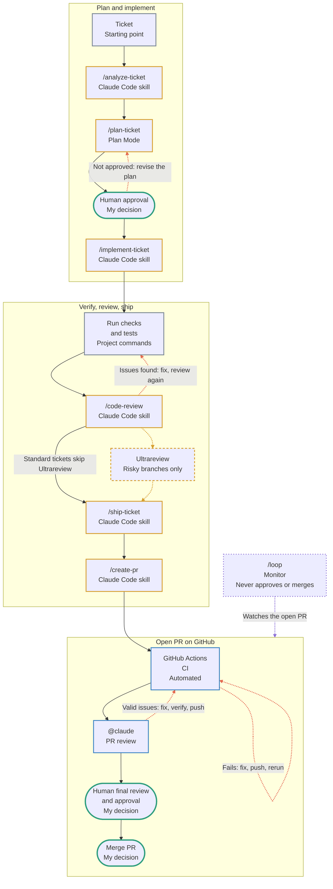
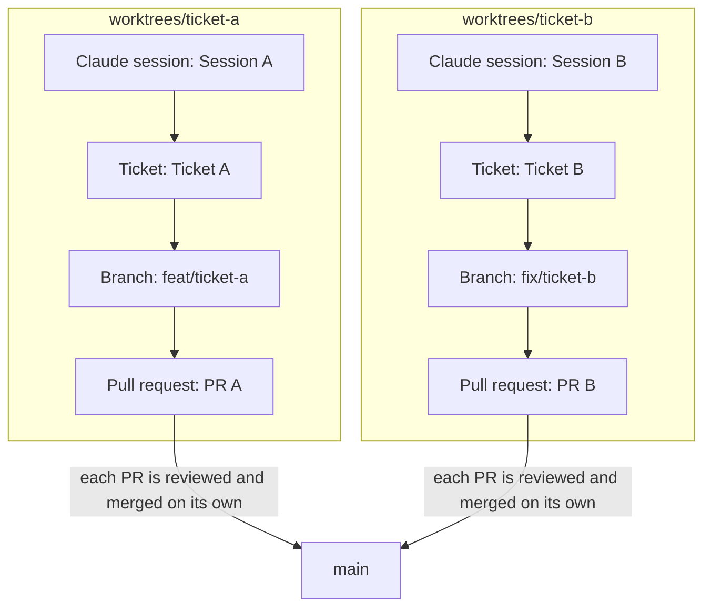
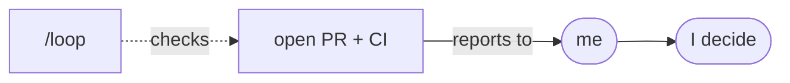
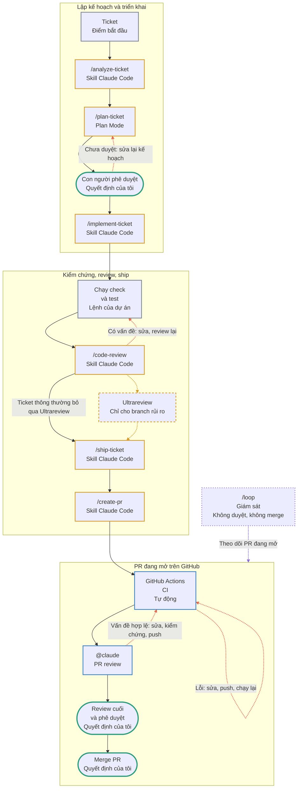
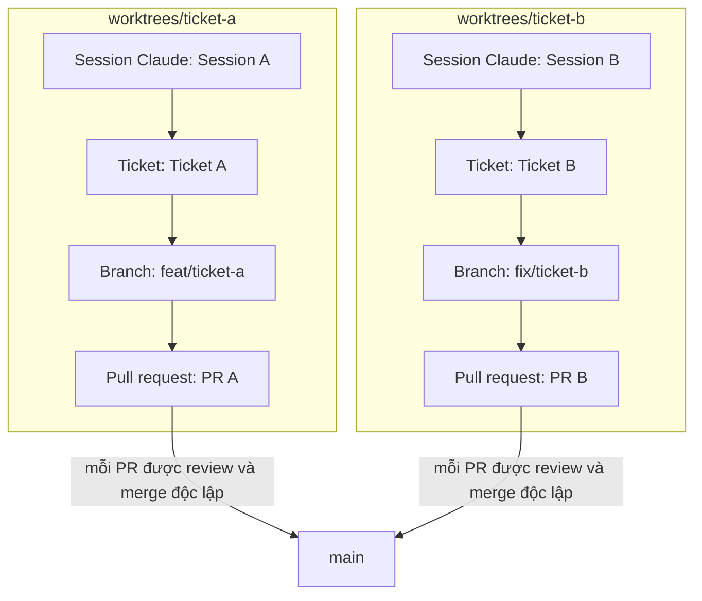
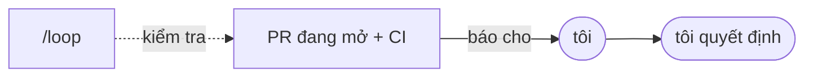

# How I Work with Claude

**Artifact:** [How I Work with Claude](https://claude.ai/artifact/DwGtBqpoHvwxJZ12WShGnv)

[English](#english) · [Tiếng Việt](#tiếng-việt)

## English

_Personal engineering playbook_

My personal AI-native development workflow — from understanding tickets and planning to implementation, code review, PR, and merge.

> “Claude helps me move faster, but **I own the requirements, the code, the verification, and the final decision**.”

| who owns what  | Owner |
| -------------- | ----- |
| requirements   | `@me` |
| code           | `@me` |
| verification   | `@me` |
| final decision | `@me` |

### My daily development workflow

_Day to day_

The sequence I follow in Claude Code for one ticket.

| #   | Step                                | What it does                                                                                                                          |
| --- | ----------------------------------- | ------------------------------------------------------------------------------------------------------------------------------------- |
| 1   | `/analyze-ticket`                   | Understand the ticket, requirements, scope, and acceptance criteria.                                                                  |
| 2   | `/plan-ticket`                      | Analyze the implementation approach and create a plan using Plan Mode. I approve it before implementation starts.                     |
| 3   | `/implement-ticket`                 | Implement the approved plan.                                                                                                          |
| 4   | **Run checks and tests**            | Verify the implementation with the relevant project commands.                                                                         |
| 5   | `/code-review`                      | Review the implementation locally before creating a PR. Identify bugs, logic issues, security concerns, and maintainability problems. |
| 6   | `Ultrareview` (risky branches only) | Multi-agent cloud review that catches what tired humans miss. I apply it to risky changes, not to every ticket.                       |
| 7   | `/ship-ticket`                      | Prepare and ship the completed work according to the project’s workflow.                                                              |
| 8   | `/create-pr`                        | Create a GitHub pull request.                                                                                                         |

### Code review and PR quality gates

_Review and verification_

Five layers, each with a different job. A change moves through them from my machine to the merge button.

#### L1: Local code review

**Skill: `/code-review`**

_The question it answers:_ Does this change hold up before anyone else sees it?

- Review the implementation before opening a PR.
- Identify bugs, logic issues, security concerns, and maintainability problems.
- Fix identified issues and review again when necessary.

#### L2: Deep review for risky changes

**Tool: Ultrareview · conditional**

_The question it answers:_ What would a single pass miss on this risky branch?

- Multi-agent cloud review.
- Catches what tired humans miss.
- Used selectively, for risky branches and changes that need deeper scrutiny.
- An additional layer, not a mandatory step for every ticket.

#### L3: Automated CI

**GitHub Actions**

_The question it answers:_ Do the project’s checks pass on the pushed code?

- Runs project checks automatically after the PR is created, such as typecheck, lint, tests, and build.
- If CI fails: investigate, fix, push updates, and wait for CI to pass.

#### L4: AI PR review

**`@claude` on GitHub**

_The question it answers:_ What does a fresh read of the whole PR find?

- Request an AI review of the PR with `@claude`.
- Inspect its findings and review comments.
- Address valid feedback, run checks again, push fixes, and request another review when necessary.

#### L5: Human final review

**Me · required**

_The question it answers:_ Should this be merged?

- Review the final diff, CI results, and review feedback.
- Human approval is required before merging.
- Merge only after all required checks and approvals are satisfied.

**Local code review, Ultrareview, CI, AI PR review, and human review complement each other. None of them replaces another.**

### End-to-end workflow

_Ticket to merge_

The table after the diagram describes each stage.



#### Diagram key

- Claude Code skill: amber
- My decision: green rounded
- GitHub: blue
- Monitor: violet dashed
- Conditional: amber dashed
- Return path: dashed coral line

#### Stages

| #   | Stage                           | Who                                    | What happens                                                                                                    | If not                                                                   |
| --- | ------------------------------- | -------------------------------------- | --------------------------------------------------------------------------------------------------------------- | ------------------------------------------------------------------------ |
| 1   | Ticket                          | Input                                  | The work begins with one ticket.                                                                                | -                                                                        |
| 2   | `/analyze-ticket`               | Claude Code skill                      | Understand the requirements, scope, and acceptance criteria.                                                    | -                                                                        |
| 3   | `/plan-ticket`                  | Claude Code skill · Plan Mode          | Analyze the approach and write a plan for me to review.                                                         | -                                                                        |
| 4   | Human approval                  | My decision                            | I read the plan and decide whether implementation can start.                                                    | revise the plan.                                                         |
| 5   | `/implement-ticket`             | Claude Code skill                      | Implement the approved plan.                                                                                    | -                                                                        |
| 6   | Run checks and tests            | Verification                           | Run the relevant project commands and read the real results.                                                    | -                                                                        |
| 7   | `/code-review`                  | Claude Code skill                      | Review locally for bugs, logic issues, security concerns, and maintainability problems.                         | fix the issues and review again.                                         |
| 8   | `Ultrareview`                   | Conditional · multi-agent cloud review | A deeper review for risky branches. Other tickets go straight to `/ship-ticket`.                                | -                                                                        |
| 9   | `/ship-ticket`                  | Claude Code skill                      | Prepare and ship the completed work according to the project’s workflow.                                        | -                                                                        |
| 10  | `/create-pr`                    | Claude Code skill                      | Create the GitHub pull request.                                                                                 | -                                                                        |
| 11  | GitHub Actions CI               | GitHub · automated                     | Project checks run automatically, such as typecheck, lint, tests, and build.                                    | fix, push, and rerun CI.                                                 |
| 12  | `@claude`                       | GitHub · AI PR review                  | I request an AI review of the PR and inspect its findings and comments.                                         | for valid issues: fix, verify, and push updates. The push runs CI again. |
| 13  | Human final review and approval | My decision                            | I review the final diff, CI results, and review feedback.                                                       | -                                                                        |
| 14  | Merge PR                        | My decision                            | Merge only after all required checks and approvals are satisfied.                                               | -                                                                        |
| 15  | `/loop`                         | Separate monitor                       | Checks the open PR and CI on an interval and reports what needs attention. It cannot approve or merge anything. | -                                                                        |

#### Decision branches

| When                              | Then                                                          |
| --------------------------------- | ------------------------------------------------------------- |
| Plan not approved                 | Revise the plan, then ask for approval again.                 |
| Local review finds issues         | Fix them and review again.                                    |
| Ultrareview                       | Optional and conditional. Only risky branches take this path. |
| CI fails                          | Fix, push, and rerun CI.                                      |
| `@claude` identifies valid issues | Fix, verify, and push updates.                                |

### Parallel work with Git worktrees

_Parallel development_

> **“Two tickets in flight, two isolated agents, zero crosstalk.”**



| Item           | worktrees/ticket-a | worktrees/ticket-b |
| -------------- | ------------------ | ------------------ |
| Claude session | `Session A`        | `Session B`        |
| Ticket         | `Ticket A`         | `Ticket B`         |
| Branch         | `feat/ticket-a`    | `fix/ticket-b`     |
| Pull request   | `PR A`             | `PR B`             |

_Illustrative names._

- Separate Git worktrees isolate branches and working directories.
- Independent tickets get separate Claude Code sessions.
- Each session has its own context and works on its own branch.
- Each ticket produces its own PR.
- Dependencies are resolved sequentially, never in parallel.
- I keep it manageable: typically 2–3 independent sessions.

### Monitoring with `/loop`

_Scheduled follow-ups_

Recurring checks while a Claude Code session remains open. It connects to the PR and CI workflow as a monitor. Decisions stay with me.



| Command                     | Purpose                                                          |
| --------------------------- | ---------------------------------------------------------------- |
| `/loop 15m`                 | Check an open PR for new review comments and unresolved issues.  |
| `/loop`                     | Monitor CI failures and report what needs attention.             |
| `/loop 5m check the deploy` | Check deployment status.                                         |
| **Morning maintenance**     | Review open PRs, CI failures, and outstanding maintenance tasks. |

#### What it does

- Rechecks status on a schedule
- Reports what needs attention

#### What it never does

- Approve a plan or a PR
- Merge or deploy
- Authorize a risky action on its own

- Recurring instructions can also be defined in `loop.md`.
- `Esc` stops the loop.

### Engineering habits

_Throughout development_

#### Real browser verification

_the running app, in a real browser_

Passing tests do not tell me what the user sees. So I always run the application and check UI and chat changes in a real browser.

- Run the application and open it in a real browser.
- Verify the actual rendered behavior and important user flows.
- Do not rely only on code inspection, screenshots of code, or automated tests.
- For chat changes, verify the actual conversation experience, interactions, and responses where applicable.

#### Short feedback loops

- Implement, verify, review, and address issues in small iterations.
- Catch problems early instead of accumulating a large unverified diff.

#### Evidence-based verification

- Run relevant commands and tests.
- Confirm actual results before reporting completion.
- Never claim a check passed if it was not run.

#### Focused changes

- Keep changes small, incremental, and easy to review.
- Avoid unrelated modifications.

### Reusable prompts

_Copy and adapt_

Replace the values in angle brackets.

#### Ticket analysis

```text
/analyze-ticket <TICKET>
Summarize the requirements, scope, and acceptance criteria. List what is unclear or missing. Ask only the questions I need to decide. Do not write code.
```

#### Planning with Plan Mode

```text
/plan-ticket <TICKET>
Use Plan Mode. Read the relevant code first, then propose the approach, affected files, risks, and how each step will be verified. Stop for my approval before implementing.
```

#### Implementation and verification

```text
/implement-ticket <TICKET>
Implement only the approved plan and keep the diff focused. Run the relevant checks and tests and report the real output. If something was not run, say so.
```

#### Real browser UI and chat verification

```text
Run the app and check this change in a real browser. Walk through <USER FLOW> and report what actually rendered and happened. For chat changes, send real messages and check the conversation, interactions, and responses. List anything you could not verify.
```

#### Local code review

```text
/code-review
Review the current changes for bugs, logic issues, security concerns, and maintainability problems. Rank findings by severity, with file and line.
```

#### Ultrareview for risky branches

```text
/code-review ultra

When the findings arrive: check each one against the code, tell me which are valid and why, fix only those I confirm, then run the checks again.
```

#### PR review and addressing feedback

```text
On GitHub:
@claude review this PR for bugs, security issues, and missing tests.

In Claude Code:
Read the review comments and CI results on PR <NUMBER>. For each one, tell me whether it is valid and why. Fix the valid ones, run the checks again, and show me the diff before pushing. Do not merge.
```

### My guardrails

_Non-negotiable_

#### Before code

- Clarify requirements before implementation.
- Plan first for complex or risky changes.
- Human approval before important plans and actions.

#### Shape of the change

- One ticket per branch and PR.
- Keep diffs small and focused.

#### Proof

- Verify with real commands, tests, and browser checks.
- Never claim checks passed if they were not run.

#### Safety

- Never expose secrets or customer data.
- Never push directly to protected branches.
- Ask before destructive Git operations or force pushes.

#### Accountability

- AI review does not replace human accountability.
- Remain accountable for the final PR and merge decision.

## Tiếng Việt

_Sổ tay kỹ thuật cá nhân_

**Cách tôi làm việc với Claude**

Quy trình phát triển AI-native của riêng tôi — từ hiểu ticket và lập kế hoạch đến triển khai, code review, PR và merge.

> “Claude giúp tôi làm nhanh hơn, nhưng **tôi chịu trách nhiệm về yêu cầu, mã nguồn, việc kiểm chứng và quyết định cuối cùng**.”

| ai chịu trách nhiệm | Người chịu trách nhiệm |
| ------------------- | ---------------------- |
| yêu cầu             | `@tôi`                 |
| mã nguồn            | `@tôi`                 |
| kiểm chứng          | `@tôi`                 |
| quyết định cuối     | `@tôi`                 |

### Quy trình phát triển hằng ngày

_Hằng ngày_

Trình tự tôi theo trong Claude Code cho mỗi ticket.

| #   | Bước                                  | Nội dung                                                                                                                       |
| --- | ------------------------------------- | ------------------------------------------------------------------------------------------------------------------------------ |
| 1   | `/analyze-ticket`                     | Hiểu ticket, yêu cầu, phạm vi và tiêu chí nghiệm thu.                                                                          |
| 2   | `/plan-ticket`                        | Phân tích hướng triển khai và lập kế hoạch bằng Plan Mode. Tôi duyệt trước khi bắt đầu triển khai.                             |
| 3   | `/implement-ticket`                   | Triển khai theo kế hoạch đã duyệt.                                                                                             |
| 4   | **Chạy check và test**                | Kiểm chứng phần triển khai bằng các lệnh phù hợp của dự án.                                                                    |
| 5   | `/code-review`                        | Review phần triển khai ở local trước khi tạo PR. Tìm lỗi, vấn đề logic, rủi ro bảo mật và vấn đề về khả năng bảo trì.          |
| 6   | `Ultrareview` (chỉ cho branch rủi ro) | Review đa agent trên cloud, bắt những gì con người mệt mỏi dễ bỏ sót. Tôi dùng cho thay đổi rủi ro, không phải cho mọi ticket. |
| 7   | `/ship-ticket`                        | Chuẩn bị và ship phần việc đã hoàn thành theo quy trình của dự án.                                                             |
| 8   | `/create-pr`                          | Tạo pull request trên GitHub.                                                                                                  |

### Code review và các cổng chất lượng PR

_Review và kiểm chứng_

Năm lớp, mỗi lớp một nhiệm vụ riêng. Thay đổi đi qua lần lượt từ máy của tôi đến nút merge.

#### L1: Code review ở local

**Skill: `/code-review`**

_Câu hỏi lớp này trả lời:_ Thay đổi này có ổn trước khi người khác nhìn thấy không?

- Review phần triển khai trước khi mở PR.
- Tìm lỗi, vấn đề logic, rủi ro bảo mật và vấn đề về khả năng bảo trì.
- Sửa các vấn đề đã phát hiện và review lại khi cần.

#### L2: Review sâu cho thay đổi rủi ro

**Công cụ: Ultrareview · có điều kiện**

_Câu hỏi lớp này trả lời:_ Một lượt review đơn sẽ bỏ sót gì trên branch rủi ro này?

- Review đa agent trên cloud.
- Bắt những gì con người mệt mỏi dễ bỏ sót.
- Dùng có chọn lọc cho branch rủi ro và thay đổi cần soi kỹ hơn.
- Là lớp bổ sung, không bắt buộc cho mọi ticket.

#### L3: CI tự động

**GitHub Actions**

_Câu hỏi lớp này trả lời:_ Các check của dự án có pass trên code đã push không?

- Tự động chạy các check của dự án sau khi tạo PR, ví dụ typecheck, lint, test và build.
- Nếu CI lỗi: điều tra, sửa, push cập nhật và chờ CI pass.

#### L4: AI PR review

**`@claude` trên GitHub**

_Câu hỏi lớp này trả lời:_ Đọc mới toàn bộ PR thì phát hiện được gì?

- Dùng `@claude` để yêu cầu AI review PR.
- Kiểm tra các phát hiện và comment review.
- Xử lý góp ý hợp lệ, chạy lại check, push bản sửa và yêu cầu review lại khi cần.

#### L5: Review cuối của con người

**Tôi · bắt buộc**

_Câu hỏi lớp này trả lời:_ Có nên merge thay đổi này không?

- Xem diff cuối, kết quả CI và phản hồi review.
- Bắt buộc có phê duyệt của con người trước khi merge.
- Chỉ merge khi mọi check và phê duyệt bắt buộc đã đạt.

**Code review ở local, Ultrareview, CI, AI PR review và review của con người bổ sung cho nhau. Không lớp nào thay thế được lớp nào.**

### Quy trình từ đầu đến cuối

_Từ ticket đến merge_

Bảng sau sơ đồ mô tả từng giai đoạn.



#### Chú giải sơ đồ

- Skill của Claude Code: vàng hổ phách
- Quyết định của tôi: xanh lá, bo tròn
- GitHub: xanh dương
- Giám sát: tím, nét đứt
- Có điều kiện: vàng hổ phách, nét đứt
- Đường quay lại: đường nét đứt màu cam san hô

#### Các giai đoạn

| #   | Giai đoạn                | Ai thực hiện                              | Việc diễn ra                                                                                                   | Nếu không đạt                                                                 |
| --- | ------------------------ | ----------------------------------------- | -------------------------------------------------------------------------------------------------------------- | ----------------------------------------------------------------------------- |
| 1   | Ticket                   | Đầu vào                                   | Công việc bắt đầu từ một ticket.                                                                               | -                                                                             |
| 2   | `/analyze-ticket`        | Skill của Claude Code                     | Hiểu yêu cầu, phạm vi và tiêu chí nghiệm thu.                                                                  | -                                                                             |
| 3   | `/plan-ticket`           | Skill của Claude Code · Plan Mode         | Phân tích hướng đi và viết kế hoạch để tôi xem xét.                                                            | -                                                                             |
| 4   | Con người phê duyệt      | Quyết định của tôi                        | Tôi đọc kế hoạch và quyết định có bắt đầu triển khai hay không.                                                | sửa lại kế hoạch.                                                             |
| 5   | `/implement-ticket`      | Skill của Claude Code                     | Triển khai theo kế hoạch đã duyệt.                                                                             | -                                                                             |
| 6   | Chạy check và test       | Kiểm chứng                                | Chạy các lệnh phù hợp của dự án và đọc kết quả thật.                                                           | -                                                                             |
| 7   | `/code-review`           | Skill của Claude Code                     | Review ở local để tìm lỗi, vấn đề logic, rủi ro bảo mật và vấn đề về khả năng bảo trì.                         | sửa vấn đề rồi review lại.                                                    |
| 8   | `Ultrareview`            | Có điều kiện · review đa agent trên cloud | Review sâu hơn cho branch rủi ro. Các ticket khác đi thẳng đến `/ship-ticket`.                                 | -                                                                             |
| 9   | `/ship-ticket`           | Skill của Claude Code                     | Chuẩn bị và ship phần việc đã hoàn thành theo quy trình của dự án.                                             | -                                                                             |
| 10  | `/create-pr`             | Skill của Claude Code                     | Tạo pull request trên GitHub.                                                                                  | -                                                                             |
| 11  | GitHub Actions CI        | GitHub · tự động                          | Các check của dự án tự động chạy, ví dụ typecheck, lint, test và build.                                        | sửa, push và chạy lại CI.                                                     |
| 12  | `@claude`                | GitHub · AI PR review                     | Tôi yêu cầu AI review PR, rồi kiểm tra các phát hiện và comment.                                               | với vấn đề hợp lệ: sửa, kiểm chứng và push cập nhật. Lần push đó chạy lại CI. |
| 13  | Review cuối và phê duyệt | Quyết định của tôi                        | Tôi xem diff cuối, kết quả CI và phản hồi review.                                                              | -                                                                             |
| 14  | Merge PR                 | Quyết định của tôi                        | Chỉ merge khi mọi check và phê duyệt bắt buộc đã đạt.                                                          | -                                                                             |
| 15  | `/loop`                  | Cơ chế giám sát riêng                     | Kiểm tra PR đang mở và CI theo chu kỳ, rồi báo những gì cần chú ý. Nó không thể duyệt hay merge bất cứ thứ gì. | -                                                                             |

#### Các nhánh quyết định

| Khi                               | Thì                                                               |
| --------------------------------- | ----------------------------------------------------------------- |
| Kế hoạch chưa được duyệt          | Sửa lại kế hoạch rồi xin duyệt lại.                               |
| Review ở local phát hiện vấn đề   | Sửa rồi review lại.                                               |
| Ultrareview                       | Không bắt buộc, có điều kiện. Chỉ branch rủi ro mới đi nhánh này. |
| CI lỗi                            | Sửa, push và chạy lại CI.                                         |
| `@claude` phát hiện vấn đề hợp lệ | Sửa, kiểm chứng và push cập nhật.                                 |

### Làm song song với Git worktree

_Phát triển song song_

> **“Hai ticket đang chạy, hai agent tách biệt, không nhiễu chéo.”**



| Mục            | worktrees/ticket-a | worktrees/ticket-b |
| -------------- | ------------------ | ------------------ |
| Session Claude | `Session A`        | `Session B`        |
| Ticket         | `Ticket A`         | `Ticket B`         |
| Branch         | `feat/ticket-a`    | `fix/ticket-b`     |
| Pull request   | `PR A`             | `PR B`             |

_Tên chỉ mang tính minh họa._

- Git worktree riêng giúp tách biệt branch và thư mục làm việc.
- Ticket độc lập chạy trong các session Claude Code riêng.
- Mỗi session có context riêng và làm trên branch riêng.
- Mỗi ticket tạo ra PR riêng.
- Phần phụ thuộc được giải quyết tuần tự, không chạy song song.
- Tôi giữ ở mức kiểm soát được: thường 2–3 session độc lập.

### Giám sát với `/loop`

_Theo dõi định kỳ_

Kiểm tra lặp lại trong khi session Claude Code vẫn mở. Nó gắn với quy trình PR và CI như một cơ chế giám sát. Quyết định vẫn thuộc về tôi.



| Lệnh                        | Mục đích                                                                       |
| --------------------------- | ------------------------------------------------------------------------------ |
| `/loop 15m`                 | Kiểm tra PR đang mở xem có comment review mới và vấn đề chưa giải quyết không. |
| `/loop`                     | Theo dõi lỗi CI và báo những gì cần chú ý.                                     |
| `/loop 5m check the deploy` | Kiểm tra trạng thái deploy.                                                    |
| **Bảo trì buổi sáng**       | Xem các PR đang mở, lỗi CI và việc bảo trì còn tồn đọng.                       |

#### Việc nó làm

- Kiểm tra lại trạng thái theo lịch
- Báo những gì cần chú ý

#### Việc nó không bao giờ làm

- Duyệt kế hoạch hoặc PR
- Merge hoặc deploy
- Tự cho phép một hành động rủi ro

- Chỉ dẫn lặp lại cũng có thể định nghĩa trong `loop.md`.
- Nhấn `Esc` để dừng loop.

### Thói quen kỹ thuật

_Xuyên suốt quá trình phát triển_

#### Kiểm chứng trên trình duyệt thật

_ứng dụng đang chạy, trên trình duyệt thật_

Test pass không cho tôi biết người dùng thấy gì. Vì vậy tôi luôn chạy ứng dụng và kiểm tra thay đổi về UI và chat trên trình duyệt thật.

- Chạy ứng dụng và mở trên trình duyệt thật.
- Kiểm chứng hành vi hiển thị thực tế và các luồng người dùng quan trọng.
- Không chỉ dựa vào đọc code, ảnh chụp code hay test tự động.
- Với thay đổi về chat, kiểm chứng trải nghiệm hội thoại, tương tác và phản hồi thực tế khi phù hợp.

#### Vòng phản hồi ngắn

- Triển khai, kiểm chứng, review và xử lý vấn đề theo từng vòng nhỏ.
- Bắt lỗi sớm thay vì tích lũy một diff lớn chưa kiểm chứng.

#### Kiểm chứng dựa trên bằng chứng

- Chạy các lệnh và test phù hợp.
- Xác nhận kết quả thật trước khi báo hoàn thành.
- Không bao giờ nói check đã pass nếu chưa chạy.

#### Thay đổi tập trung

- Giữ thay đổi nhỏ, tăng dần và dễ review.
- Tránh sửa những phần không liên quan.

### Prompt dùng lại

_Sao chép và điều chỉnh_

Thay các giá trị trong dấu ngoặc nhọn.

#### Phân tích ticket

```text
/analyze-ticket <TICKET>
Tóm tắt yêu cầu, phạm vi và tiêu chí nghiệm thu. Liệt kê những gì chưa rõ hoặc còn thiếu. Chỉ hỏi những câu tôi cần quyết định. Không viết code.
```

#### Lập kế hoạch với Plan Mode

```text
/plan-ticket <TICKET>
Dùng Plan Mode. Đọc code liên quan trước, rồi đề xuất hướng làm, các file bị ảnh hưởng, rủi ro và cách kiểm chứng từng bước. Dừng lại chờ tôi duyệt trước khi triển khai.
```

#### Triển khai và kiểm chứng

```text
/implement-ticket <TICKET>
Chỉ triển khai theo kế hoạch đã duyệt và giữ diff tập trung. Chạy các check và test phù hợp, báo đúng kết quả thật. Nếu có gì chưa chạy, hãy nói rõ.
```

#### Kiểm chứng UI và chat trên trình duyệt thật

```text
Chạy ứng dụng và kiểm tra thay đổi này trên trình duyệt thật. Đi qua <LUỒNG NGƯỜI DÙNG> và báo những gì thực sự hiển thị và xảy ra. Với thay đổi về chat, hãy gửi tin nhắn thật và kiểm tra hội thoại, tương tác và phản hồi. Liệt kê những gì chưa kiểm chứng được.
```

#### Code review ở local

```text
/code-review
Review các thay đổi hiện tại để tìm lỗi, vấn đề logic, rủi ro bảo mật và vấn đề về khả năng bảo trì. Xếp phát hiện theo mức độ nghiêm trọng, kèm file và dòng.
```

#### Ultrareview cho branch rủi ro

```text
/code-review ultra

Khi có kết quả: đối chiếu từng phát hiện với code, cho tôi biết cái nào hợp lệ và vì sao, chỉ sửa những cái tôi xác nhận, rồi chạy lại các check.
```

#### PR review và xử lý phản hồi

```text
Trên GitHub:
@claude review PR này để tìm lỗi, vấn đề bảo mật và test còn thiếu.

Trong Claude Code:
Đọc comment review và kết quả CI của PR <SỐ PR>. Với từng mục, cho tôi biết có hợp lệ không và vì sao. Sửa các mục hợp lệ, chạy lại check và cho tôi xem diff trước khi push. Không merge.
```

### Nguyên tắc của tôi

_Không thỏa hiệp_

#### Trước khi code

- Làm rõ yêu cầu trước khi triển khai.
- Lập kế hoạch trước cho thay đổi phức tạp hoặc rủi ro.
- Con người phê duyệt trước các kế hoạch và hành động quan trọng.

#### Hình dạng thay đổi

- Mỗi ticket một branch và một PR.
- Giữ diff nhỏ và tập trung.

#### Bằng chứng

- Kiểm chứng bằng lệnh thật, test thật và kiểm tra trên trình duyệt.
- Không bao giờ nói check đã pass nếu chưa chạy.

#### An toàn

- Không bao giờ làm lộ secret hoặc dữ liệu khách hàng.
- Không bao giờ push thẳng vào branch được bảo vệ.
- Hỏi trước khi thực hiện thao tác Git mang tính phá hủy hoặc force push.

#### Trách nhiệm

- AI review không thay thế trách nhiệm của con người.
- Tôi vẫn chịu trách nhiệm về PR cuối cùng và quyết định merge.

---

Artifact by Ngan Tong
